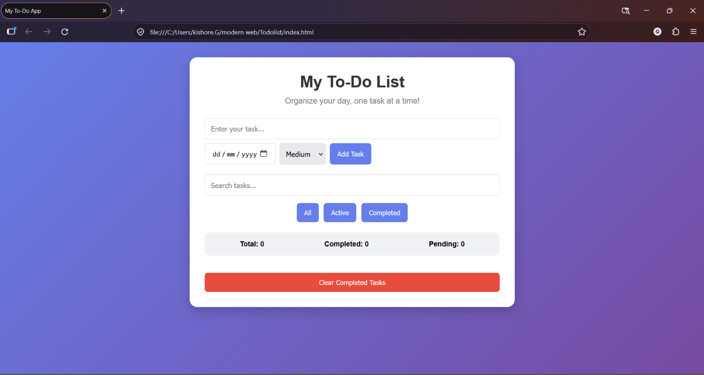

# Ex03 To-Do List using JavaScript
## Date: 

## AIM
To create a To-do Application with all features using JavaScript.

## ALGORITHM
### STEP 1
Build the HTML structure (index.html).

### STEP 2
Style the App (style.css).

### STEP 3
Plan the features the To-Do App should have.

### STEP 4
Create a To-do application using Javascript.

### STEP 5
Add functionalities.

### STEP 6
Test the App.

### STEP 7
Open the HTML file in a browser to check layout and functionality.

### STEP 8
Fix styling issues and refine content placement.

### STEP 9
Deploy the website.

### STEP 10
Upload to GitHub Pages for free hosting.

## PROGRAM
HTML COPE
```

<!DOCTYPE html>
<html lang="en">
<head>
    <meta charset="UTF-8">
    <meta name="viewport" content="width=device-width, initial-scale=1.0">
    <title>My To-Do App</title>
    <link rel="stylesheet" href="style.css">
</head>
<body>

    <div class="container">
        <header>
            <h1>My To-Do List</h1>
            <p>Organize your day, one task at a time!</p>
        </header>

        <div class="task-input">
            <input type="text" id="taskInput"
                placeholder="Enter your task...">

            <input type="date" id="taskDate">

            <select id="priority">
                <option value="Low">Low</option>
                <option value="Medium" selected>Medium</option>
                <option value="High">High</option>
            </select>

            <button onclick="addTask()">Add Task</button>
        </div>

        <input type="text" id="searchInput"
            placeholder="Search tasks..." oninput="displayTasks()">

        <div class="filters">
            <button onclick="filterTasks('all')">All</button>
            <button onclick="filterTasks('active')">Active</button>
            <button onclick="filterTasks('completed')">Completed</button>
        </div>

        <div class="stats">
            <p>Total: <span id="totalTasks">0</span></p>
            <p>Completed: <span id="completedTasks">0</span></p>
            <p>Pending: <span id="pendingTasks">0</span></p>
        </div>

        <ul id="taskList"></ul>

        <button class="clear-btn" onclick="clearCompleted()">
            Clear Completed Tasks
        </button>
    </div>

    <script src="script.js"></script>
</body>
</html>

```

CSS CODE
```

* {
    margin: 0;
    padding: 0;
    box-sizing: border-box;
}

body {
    font-family: Arial, sans-serif;
    background: linear-gradient(135deg, #667eea, #764ba2);
    min-height: 100vh;
    padding: 30px 15px;
}

.container {
    max-width: 650px;
    margin: auto;
    background: white;
    padding: 30px;
    border-radius: 15px;
    box-shadow: 0 8px 25px rgba(0,0,0,0.2);
}

header {
    text-align: center;
    margin-bottom: 25px;
}

header h1 {
    color: #333;
    margin-bottom: 10px;
}

header p {
    color: #777;
}

.task-input {
    display: flex;
    flex-wrap: wrap;
    gap: 8px;
    margin-bottom: 20px;
}

input, select {
    padding: 12px;
    border: 1px solid #ddd;
    border-radius: 6px;
    font-size: 14px;
    min-width: 0;
}

#taskInput {
    flex: 1 1 100%;
}

button {
    padding: 11px 15px;
    border: none;
    border-radius: 6px;
    background: #667eea;
    color: white;
    cursor: pointer;
    transition: 0.3s;
}

button:hover {
    background: #4b5fc7;
}

#searchInput {
    width: 100%;
    margin-bottom: 15px;
}

.filters {
    display: flex;
    gap: 10px;
    justify-content: center;
    margin-bottom: 20px;
}

.stats {
    display: flex;
    justify-content: space-around;
    background: #f1f2f6;
    padding: 15px;
    border-radius: 8px;
    margin-bottom: 20px;
    flex-wrap: wrap;
    gap: 10px;
}

.stats p {
    font-size: 14px;
    font-weight: bold;
}

#taskList {
    list-style: none;
}

#taskList li {
    display: flex;
    align-items: center;
    justify-content: space-between;
    gap: 10px;
    padding: 15px;
    margin-bottom: 10px;
    background: #f8f9fa;
    border-left: 5px solid #667eea;
    border-radius: 6px;
    overflow-wrap: anywhere;
}

.task-info {
    flex: 1;
    min-width: 0;
}

.task-info p {
    margin-top: 5px;
    color: #777;
    font-size: 12px;
}

.completed {
    text-decoration: line-through;
    color: gray;
}

.task-actions {
    display: flex;
    flex-wrap: wrap;
    gap: 5px;
}

.edit-btn {
    background: #f39c12;
}

.delete-btn {
    background: #e74c3c;
}

.clear-btn {
    width: 100%;
    margin-top: 15px;
    background: #e74c3c;
}

.priority {
    font-size: 12px;
    font-weight: bold;
}

.empty {
    text-align: center;
    color: gray;
    padding: 20px;
}

@media (max-width: 480px) {
    .container {
        padding: 20px 15px;
    }

    .task-input > * {
        flex: 1 1 100%;
    }

    .stats {
        flex-direction: column;
        text-align: center;
    }

    #taskList li {
        align-items: flex-start;
        flex-direction: column;
    }
}

```
JS CODE
```

let tasks = JSON.parse(localStorage.getItem("tasks")) || [];
let currentFilter = "all";

// Save tasks to Local Storage
function saveTasks() {
    localStorage.setItem("tasks", JSON.stringify(tasks));
}

// Add new task
function addTask() {
    const input = document.getElementById("taskInput");
    const date = document.getElementById("taskDate");
    const priority = document.getElementById("priority");

    const taskName = input.value.trim();

    if (taskName === "") {
        alert("Please enter a task!");
        return;
    }

    const task = {
        id: Date.now(),
        name: taskName,
        date: date.value,
        priority: priority.value,
        completed: false
    };

    tasks.push(task);

    saveTasks();
    displayTasks();

    input.value = "";
    date.value = "";
    priority.value = "Medium";
}

// Display tasks
function displayTasks() {
    const taskList = document.getElementById("taskList");
    const search = document.getElementById("searchInput")
        .value.toLowerCase();

    taskList.innerHTML = "";

    let filteredTasks = tasks.filter(task => {
        const matchesSearch = task.name.toLowerCase().includes(search);

        const matchesFilter =
            currentFilter === "all" ||
            (currentFilter === "active" && !task.completed) ||
            (currentFilter === "completed" && task.completed);

        return matchesSearch && matchesFilter;
    });

    if (filteredTasks.length === 0) {
        taskList.innerHTML =
            '<li class="empty">No tasks found!</li>';
    }

    filteredTasks.forEach(task => {
        const li = document.createElement("li");

        const info = document.createElement("div");
        info.className = "task-info";

        const name = document.createElement("strong");
        name.textContent = task.name;

        if (task.completed) {
            name.classList.add("completed");
        }

        const details = document.createElement("p");
        details.textContent =
            `Priority: ${task.priority} | Due: ${task.date || "No date"}`;

        const actions = document.createElement("div");
        actions.className = "task-actions";

        const completeBtn = document.createElement("button");
        completeBtn.textContent = task.completed ? "Undo" : "Done";
        completeBtn.onclick = () => toggleTask(task.id);

        const editBtn = document.createElement("button");
        editBtn.textContent = "Edit";
        editBtn.className = "edit-btn";
        editBtn.onclick = () => editTask(task.id);

        const deleteBtn = document.createElement("button");
        deleteBtn.textContent = "Delete";
        deleteBtn.className = "delete-btn";
        deleteBtn.onclick = () => deleteTask(task.id);

        info.append(name, details);
        actions.append(completeBtn, editBtn, deleteBtn);

        li.append(info, actions);
        taskList.appendChild(li);
    });

    updateStats();
}

// Complete or undo task
function toggleTask(id) {
    tasks = tasks.map(task =>
        task.id === id
            ? { ...task, completed: !task.completed }
            : task
    );

    saveTasks();
    displayTasks();
}

// Edit task
function editTask(id) {
    const task = tasks.find(task => task.id === id);

    const newName = prompt("Edit your task:", task.name);

    if (newName === null) return;

    if (newName.trim() === "") {
        alert("Task name cannot be empty!");
        return;
    }

    task.name = newName.trim();

    saveTasks();
    displayTasks();
}

// Delete task
function deleteTask(id) {
    if (confirm("Are you sure you want to delete this task?")) {
        tasks = tasks.filter(task => task.id !== id);

        saveTasks();
        displayTasks();
    }
}

// Filter tasks
function filterTasks(filter) {
    currentFilter = filter;
    displayTasks();
}

// Update task statistics
function updateStats() {
    const total = tasks.length;
    const completed = tasks.filter(task => task.completed).length;
    const pending = total - completed;

    document.getElementById("totalTasks").textContent = total;
    document.getElementById("completedTasks").textContent = completed;
    document.getElementById("pendingTasks").textContent = pending;
}

// Clear completed tasks
function clearCompleted() {
    if (confirm("Delete all completed tasks?")) {
        tasks = tasks.filter(task => !task.completed);

        saveTasks();
        displayTasks();
    }
}

// Initial display
displayTasks();
```

## OUTPUT



## RESULT
The program for creating To-do list using JavaScript is executed successfully.
